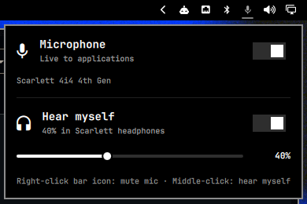

# Scarlett Mic Control for Omarchy

A small, theme-aware Omarchy bar widget for the two microphone controls that
are easy to confuse:

- **Microphone** controls what Discord, OBS, games, recordings, and other people
  receive.
- **Hear myself** independently controls compatible Scarlett zero-latency
  headphone monitoring.

Normal speakers, headphones, Bluetooth devices, and application routing remain
under Omarchy's built-in audio widget.



## Install

```bash
omarchy plugin add https://github.com/TheTrueFerret/scarlett-mic-control-omarchy.git --enable
```

The widget is placed on the right side of the bar by default. If it does not
appear immediately, restart the shell:

```bash
omarchy restart shell
```

## Controls

| Action | Result |
| --- | --- |
| Left-click the bar icon | Open the control panel |
| Right-click the bar icon | Mute or unmute the Scarlett microphone for applications |
| Middle-click the bar icon | Toggle compatible hardware monitoring |
| Scroll over the bar icon | Adjust hardware-monitor volume |
| `M` in the panel | Toggle microphone capture mute |
| `H` in the panel | Toggle headphone monitoring |

The panel uses separate switches so muting yourself for a call never silently
changes what you hear in the headphones, and disabling monitoring never mutes
the recording source.

## Compatibility

### Microphone mute

Capture mute is designed to work with **any Scarlett interface exposed as an
audio input by PipeWire**. The plugin discovers connected devices from their
Scarlett metadata and prefers the system's default Scarlett input when several
are connected.

### Hardware monitoring

Zero-latency monitoring varies substantially between Scarlett generations and
models. The current adapter is tested on the **Scarlett 4i4 4th Gen** and is
enabled only when ALSA exposes both of these mixer controls:

```text
Mix E Input 01
Mix F Input 01
```

On another Scarlett model, microphone mute can still work even if **Hear
myself** is shown as unavailable. The plugin deliberately avoids guessing at
unknown hardware routes. Use the interface's physical Direct Monitor control or
[ALSA Scarlett Control Panel](https://github.com/geoffreybennett/alsa-scarlett-gui)
for unsupported monitoring layouts.

## Requirements

- Omarchy with Quickshell plugin support
- PipeWire with its PulseAudio-compatible server (`pactl`)
- ALSA utilities (`amixer`) for hardware monitoring
- Python 3
- A Linux driver and firmware combination that exposes the controls supported
  by your Scarlett model

On Omarchy, `pactl`, `amixer`, and Python are normally already available.

## Updating and removing

```bash
omarchy plugin update io.github.thetrueferret.scarlett-mic-control
omarchy plugin remove io.github.thetrueferret.scarlett-mic-control
```

The plugin writes only its remembered monitor level to:

```text
~/.config/omarchy/scarlett-mic-control.json
```

Removing the plugin does not alter normal Omarchy audio settings or delete this
small preferences file.

## Troubleshooting

Check what the backend detects:

```bash
python3 ~/.config/omarchy/plugins/io.github.thetrueferret.scarlett-mic-control/scarlett_monitor.py status | jq
```

Confirm that PipeWire sees the interface:

```bash
pactl list short sources
```

Check whether the compatible monitoring controls exist, replacing `Gen` with
the ALSA card id shown on your system:

```bash
amixer -c Gen scontrols | grep 'Mix [EF] Input 01'
```

After updating plugin code, use `omarchy restart shell` if the old component is
still cached.

## Development

Validate the plugin using the same manifest checks as the Omarchy installer:

```bash
omarchy plugin validate .
python3 -m unittest discover -s tests -v
python3 -m py_compile scarlett_monitor.py
```

Omarchy plugins run as unsandboxed user code. This plugin executes fixed local
`pactl` and `amixer` commands; it performs no network requests and reads no
credentials.

See Omarchy's [shell plugin documentation](https://github.com/basecamp/omarchy/blob/quattro/manual/32-shell-plugins.md)
for the plugin lifecycle and manifest format.

## License

[MIT](LICENSE)
